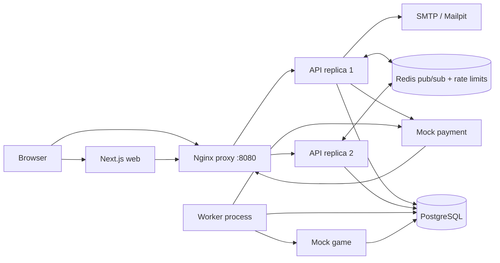

# สถาปัตยกรรมระบบ



## Checkout และการเติมสินค้า

```mermaid
sequenceDiagram
  participant B as Browser
  participant A as API
  participant D as PostgreSQL
  participant P as Mock payment
  participant W as Worker
  participant G as Mock game
  participant R as Redis
  B->>A: POST /orders + Idempotency-Key
  A->>D: lock product and voucher; reserve stock; save price snapshot
  A-->>B: pending order + tracking token
  B->>P: simulate payment result
  P->>A: signed POST /webhooks/payment
  A->>D: deduplicate event; transition to PAID; create fulfillment job
  A->>R: publish persisted order event
  W->>D: claim queued job with SKIP LOCKED
  W->>G: GET top-up by stable order reference
  alt no prior top-up exists
    W->>G: POST top-up
  end
  G-->>W: confirmed status or timeout
  W->>D: complete or schedule retry/dead-letter
  W->>R: publish order event
  B->>A: SSE with tracking token and Last-Event-ID
  A->>D: replay missed events
  A->>R: subscribe to events from either replica
```

Worker ตรวจสอบสถานะที่บันทึกไว้ของ mock game ก่อนส่ง POST ทุกครั้ง วิธีนี้ช่วยกู้คืนกรณีหมดเวลาแบบคลุมเครือ ซึ่งการเติมเกมสำเร็จแล้วแต่ response HTTP สูญหาย PostgreSQL เป็นแหล่งข้อมูลหลักของคำสั่งซื้อและสถานะงาน ส่วน Redis ใช้กระจายเฉพาะเหตุการณ์ที่บันทึกลงฐานข้อมูลแล้วและเก็บตัวนับจำกัดอัตราคำขอ

## การยืนยันตัวตนและการจัดการระบบ

API ส่งรหัสตัวเลขหกหลักที่ใช้ครั้งเดียวผ่าน SMTP relay ที่กำหนด OTP challenge มีอายุสั้น จำกัดจำนวนครั้ง และจัดเก็บเป็น HMAC digest เมื่อยืนยันสำเร็จ ระบบจะออก session token แบบ opaque ที่สุ่มขึ้น โดยบันทึกเฉพาะ SHA-256 digest ลงฐานข้อมูล และโหลด role ปัจจุบันจาก PostgreSQL ทุกคำขอ allowlist `ADMIN_EMAILS` เป็นตัวกำหนดการให้และเพิกถอนสิทธิ์ผู้ดูแล การเขียนข้อมูลที่ยืนยันตัวตนด้วย cookie ต้องมาจาก same-origin ที่อนุญาต และการเปลี่ยนแปลงโดยผู้ดูแลจะสร้าง audit record

## การกระทบยอด

ผู้ดูแลระบบอัปโหลดไฟล์ CSV settlement ที่จำกัดขนาดไว้ ระบบเปรียบเทียบแต่ละเหตุการณ์ของผู้ให้บริการกับเหตุการณ์ signed-webhook และ snapshot ของคำสั่งซื้อที่บันทึกไว้ พร้อมรายงานเหตุการณ์ชำระเงินสำเร็จ/คืนเงินภายในที่ไม่อยู่ในไฟล์ ผลลัพธ์ของแต่ละ batch ถูกบันทึกใน PostgreSQL เพื่อให้ตรวจสอบได้ โดยไม่เปลี่ยนสถานะคำสั่งซื้อ/การชำระเงินอย่างเงียบ ๆ

## การจัดการเมื่อเกิดข้อผิดพลาด

- **API replica หยุดทำงาน:** Nginx ยังคงส่งคำขอไปยัง replica ที่พร้อมใช้งาน และข้อมูลคำสั่งซื้อกับ idempotency ถูกใช้ร่วมกันผ่าน PostgreSQL
- **Redis ใช้งานไม่ได้:** `/readyz` จะไม่รายงานว่าพร้อมใช้งาน การอ่าน/เขียนคำสั่งซื้ออาจยังทำได้ แต่ไม่สามารถรับประกันการกระจาย event และการจำกัดอัตราคำขอสำหรับ tracking จนกว่า Redis จะกลับมา
- **Payment webhook ซ้ำ:** `payment_webhook_events.event_id` มี unique constraint การส่งซ้ำจะได้รับ success โดยไม่ทำ transition ซ้ำ
- **ยอดชำระไม่ถูกต้อง:** คำสั่งซื้อจะเปลี่ยนเป็น `NEEDS_REVIEW` และไม่มีการสร้าง fulfillment job
- **ได้รับการชำระเงินหลังคำสั่งซื้อหมดอายุ:** API พยายามจองสต็อกอีกครั้ง หากไม่มีสต็อกจะจัดคิวคืนเงินอัตโนมัติ
- **Game timeout:** worker ลองใหม่ด้วย exponential backoff และ jitter พร้อมตรวจสถานะเกมก่อนส่งงานอีกครั้ง
- **Worker หยุดทำงานขณะถือครองงาน:** งานที่ถูกล็อกเกินสองนาทีจะถูกเปลี่ยนให้ลองใหม่ได้
- **การเติมสินค้าล้มเหลวต่อเนื่อง:** งานจะถูกทำเครื่องหมายเป็น dead และเข้าคิวคืนเงินอัตโนมัติ ผู้ดูแลเวรควรตรวจสอบคำสั่งซื้อและสถานะจากผู้ให้บริการด้วย
