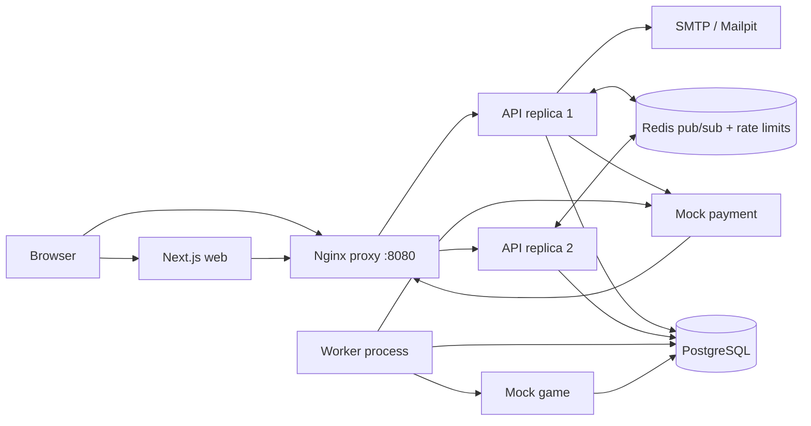

# Architecture



## Checkout and fulfillment

```mermaid
sequenceDiagram
  participant B as Browser
  participant A as API
  participant D as PostgreSQL
  participant P as Mock payment
  participant W as Worker
  participant G as Mock game
  participant R as Redis
  B->>A: POST /orders + Idempotency-Key
  A->>D: lock product and voucher; reserve stock; save price snapshot
  A-->>B: pending order + tracking token
  B->>P: simulate payment result
  P->>A: signed POST /webhooks/payment
  A->>D: deduplicate event; transition to PAID; create fulfillment job
  A->>R: publish persisted order event
  W->>D: claim queued job with SKIP LOCKED
  W->>G: GET top-up by stable order reference
  alt no prior top-up exists
    W->>G: POST top-up
  end
  G-->>W: confirmed status or timeout
  W->>D: complete or schedule retry/dead-letter
  W->>R: publish order event
  B->>A: SSE with tracking token and Last-Event-ID
  A->>D: replay missed events
  A->>R: subscribe to events from either replica
```

The worker checks the mock game's persisted status before every POST. This recovers the ambiguous timeout case where a game top-up succeeded but its HTTP response was lost. PostgreSQL owns order and job state; Redis only distributes already-persisted events and rate-limit counters.

## Authentication and administration

The API emails one-time six-digit codes through the configured SMTP relay. OTP challenges are short-lived, attempt-limited, and stored as HMAC digests. Successful verification issues a random opaque session token; only its SHA-256 digest is persisted, and each request loads the current role from PostgreSQL. The `ADMIN_EMAILS` allowlist controls admin assignment and revocation. Cookie-authenticated writes require the configured same-origin allowlist, and admin mutations create audit records.

## Settlement reconciliation

Administrators upload bounded CSV settlement files. Each provider event is compared with the persisted signed-webhook event and order snapshot; internal successful/refund events absent from the file are also reported. Batch rows and results are stored in PostgreSQL for review rather than silently changing order/payment state.

## Failure handling

- **API replica exits:** Nginx continues routing to the healthy replica; the order and idempotency records are shared in PostgreSQL.
- **Redis unavailable:** `/readyz` fails closed; order reads/writes may still work, but event fan-out and tracking rate limiting cannot be guaranteed until Redis recovers.
- **Payment webhook duplicate:** `payment_webhook_events.event_id` is unique; repeated delivery returns success without repeating the transition.
- **Wrong payment amount:** the order enters `NEEDS_REVIEW`; no fulfillment job is created.
- **Payment arrives after expiry:** the API attempts to reserve stock again; if unavailable it schedules an automatic refund.
- **Game timeout:** the worker retries with exponential backoff and jitter, and checks game status before another delivery attempt.
- **Worker exits while holding a job:** jobs locked for over two minutes are made retryable.
- **Persistent fulfillment failure:** the job is marked dead and an automatic refund is queued; on-call should also review the order and provider state.
